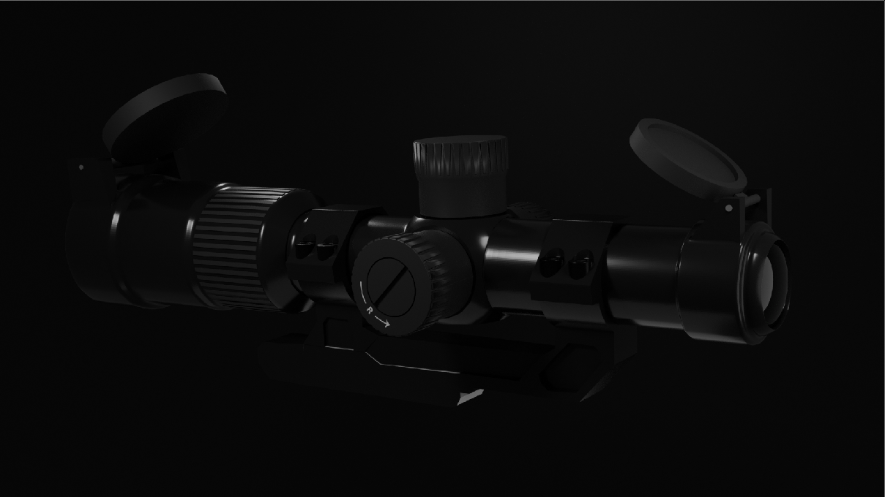

# 3X Variable Optic — Blender 3D

A detailed 3D model of a variable-style optical scope, created in Blender. This project focuses on hard-surface modeling, mechanical details, realistic materials, and cinematic lighting.

## Scope Render

## Overview

This project explores realistic hard-surface modeling through a detailed optical scope featuring adjustment turrets, textured adjustment rings, lens housings, protective flip-up covers, mounting hardware, and small directional markings.

The model was refined through additional mechanical details and lighting to create a more polished, realistic presentation.

## Skills Demonstrated

- Hard-surface 3D modeling
- Mechanical detailing
- Material creation and surface finishing
- UV mapping and image texturing
- Studio lighting and composition
- 3D rendering with Blender

## Project Files

| File | Description |
|---|---|
| `3X-Scope.blend` | Blender source project |
| `Scope_Picture_3X.PNG` | Final rendered scope image |

## Software

- **Blender** — Modeling, materials, lighting, and rendering

## Author

**Gursehbaj Singh**  
3D Modeling & Blender Artist

## License

Created for personal portfolio and educational purposes. Please contact the author before redistributing or commercially using the project files.
